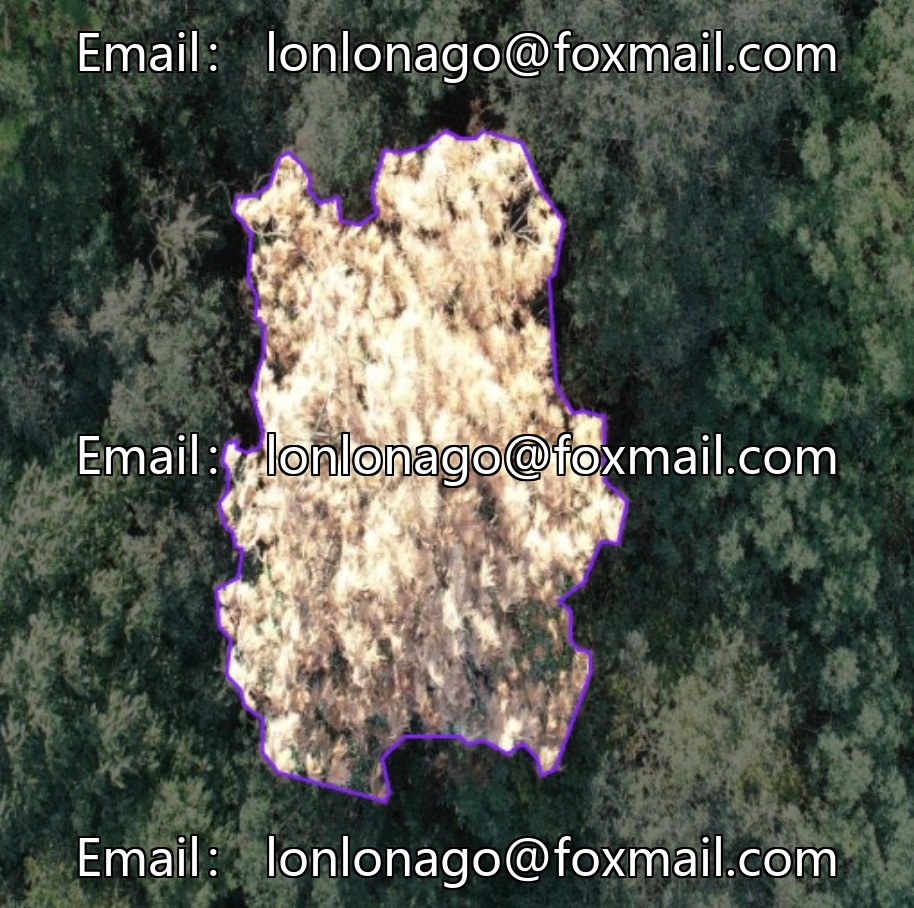
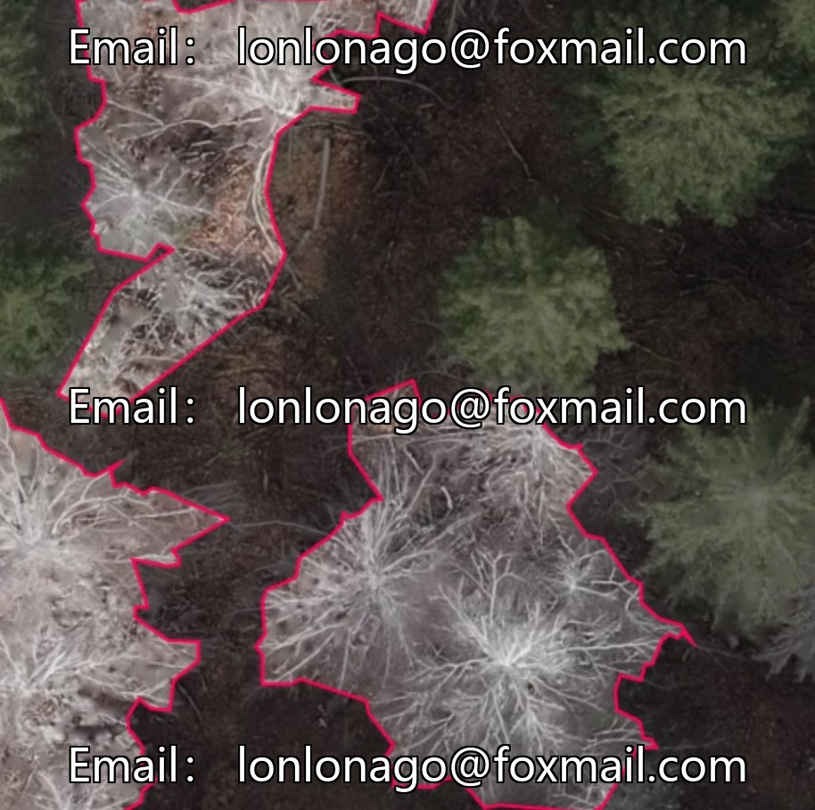
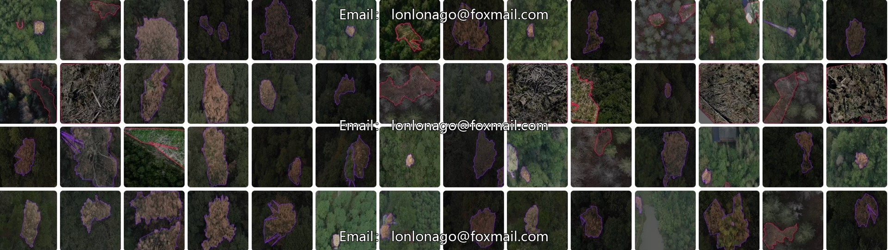
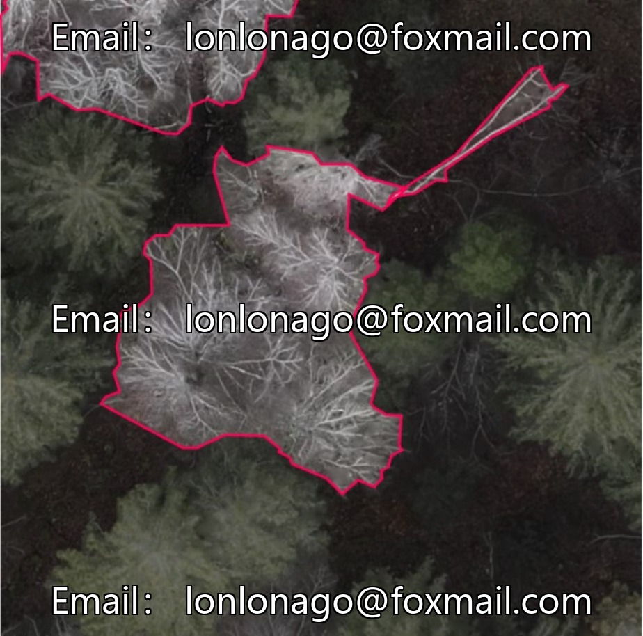
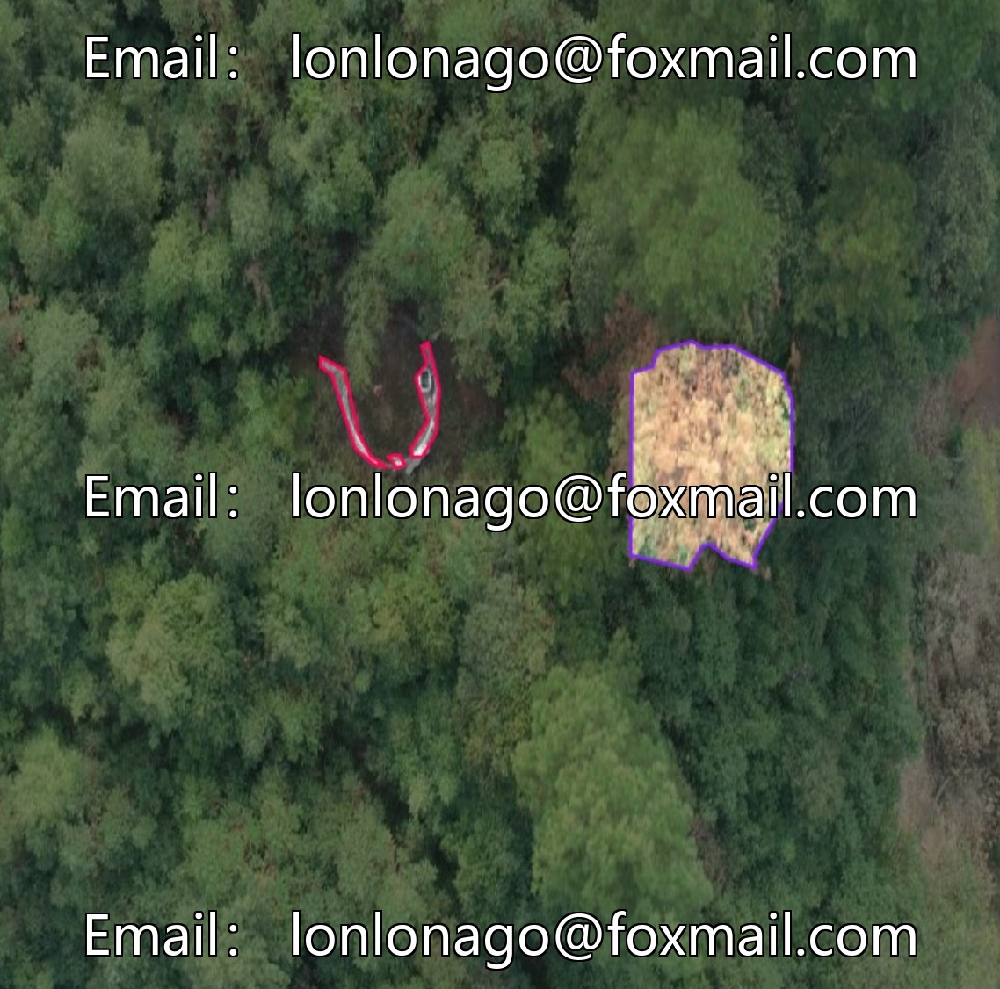
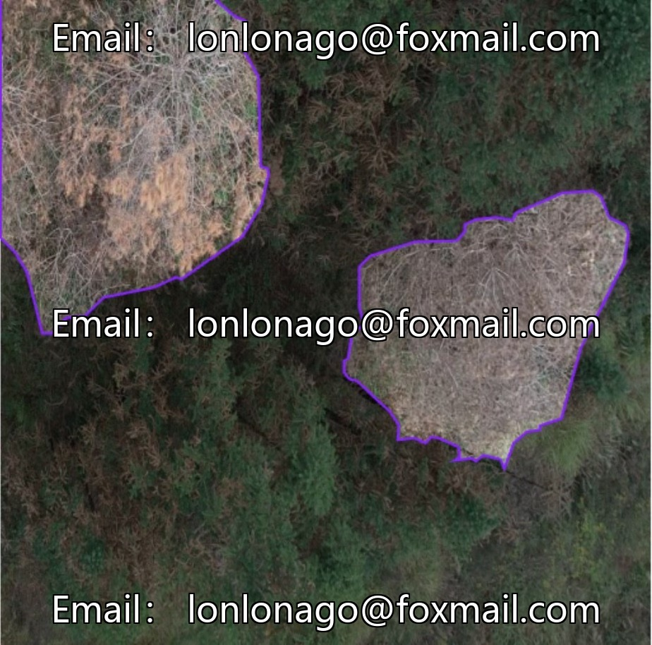

# Intelligent Forestry Drone Inspection Data Set, Pine Wilt Disease Segmentation and Recognition, 200 labeled images

## Body

Intelligent Forestry Drone Inspection Data Set, Pine Wilt Disease Segmentation and Recognition, 200 labeled images. Complementary specialized data system. Suitable for instance segmentation tasks. Supports the Yolov1 image recognition version 10285.

Focus on data-driven identification of pine wilt disease, with no extraneous tasks interfering. 200 labeled images cover various scenarios, managed through a unified data system, meeting the training needs of medium and small models. Professional annotation format directly interfaces with instance segmentation model training, eliminating the need for format conversion.

Virtual materials, once sold, are non-refundable.
Interested friends, click "I want" to proceed.

## Images

## Payment

Here is a pay link on Stripe ( https://buy.stripe.com/3cs8yP7sY87d0vu9AB ). Please contact me lonlonago@foxmail.com after funding $89, and I will send you a complete data files , thank you!

